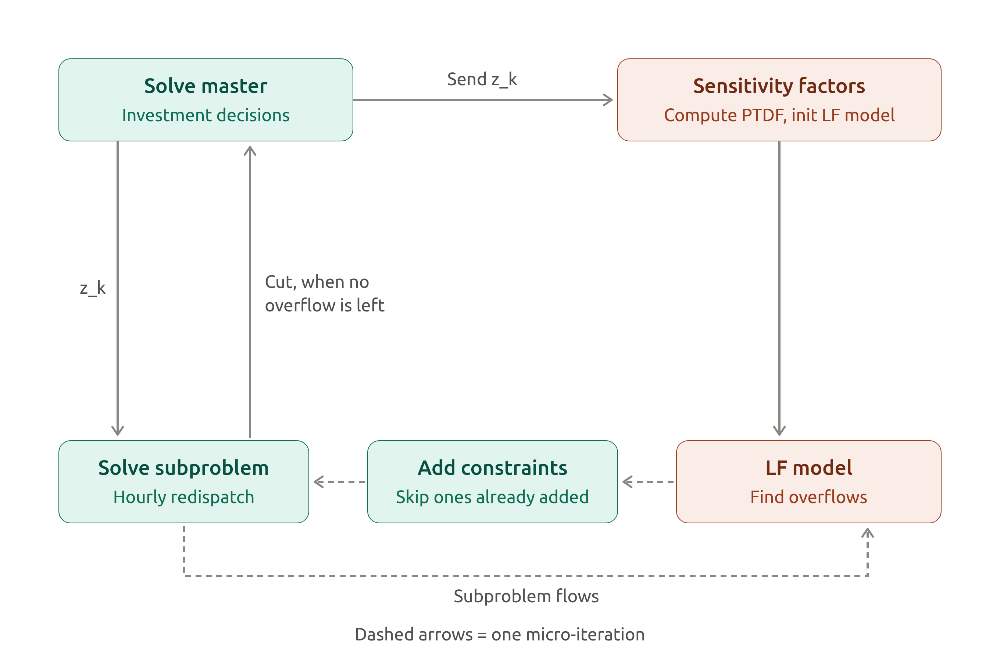
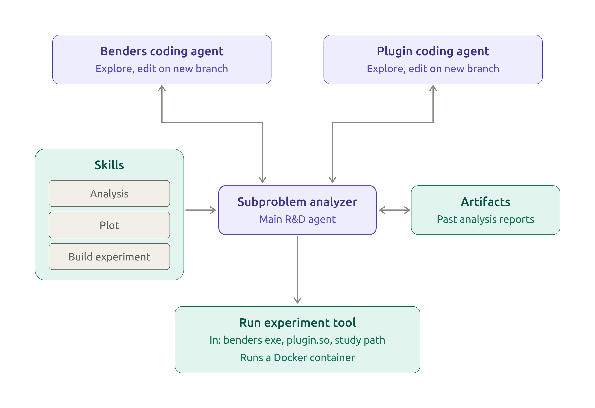

# Accelerating R&D with Agents

**Use case:** studying security-constrained redispatch subproblems in Benders decomposition.

<!-- more -->

## Context

[Antares-Xpansion](https://github.com/AntaresSimulatorTeam/antares-xpansion) is a transmission
expansion planning tool built on **Benders decomposition**. We use it to study how the electrical
grid should grow. We consider a set of candidate lines $Z$ and the operating cost $\theta_h$ of
each hour $h$. The objective is:

$$
\min \; \sum_{l \in Z} c_l \, z_l \;+\; \sum_{h} \theta_h
$$

where the first term is the investment cost of the chosen lines and the second is the total
operating cost.

Benders decomposition splits this problem into two parts:

- a **master problem** (mixed-integer linear) that decides which lines to build;
- a set of **subproblems**, one per hour, that compute the redispatch and its operating cost for
  the chosen grid.

## Subproblems and the micro-iteration mechanism

The subproblems are **security-constrained redispatch** problems. At the optimum, most of their
constraints, especially the flow constraints, are not binding. We use this with a
**micro-iteration mechanism**. We start from a relaxed problem that keeps only the
generation-unit constraints. Then we add flow constraints step by step, following the mechanism
below:

## Where AI comes in

This approach gave a large speed-up for the whole Benders decomposition. But our implementation
added several **hyperparameters and design choices** that could be made differently. Examples are
how many constraints to add at each step, which violated flows to pick first, and when to stop.
Tuning them means running many experiments and analysing the metrics to find ideas that improve
performance further. These ideas often come from knowledge of grid modelling and linear
optimization.

To speed up this work, we built an **agent harness**. It designs and runs the experiments,
collects the metrics, and helps us read the results.

## Defining the metrics

### Metrics we track

Our goal is to **reduce the total Benders run time** by cutting the cumulative time spent solving
subproblems at each iteration.

For this, we track the following for every subproblem at every Benders iteration:

- the number of micro-iterations;
- the cumulative time spent in micro-iterations;
- the share of N-K and K constraints added at each micro-iteration.

We also compare added constraints across two dimensions:

- **Between subproblems (across hours):** which added constraints are common, and which of them
  are active at the optimum. The aim is to find heuristics that let us solve one hour faster by
  reusing the solution found for a previous hour.
- **Across iterations (same subproblem):** which constraints added at iteration $k$ are added
  again, or are active, at iteration $k+1$. This tells us whether it is worth warm-starting a
  subproblem at iteration $k+1$ by injecting the constraints added at iteration $k$ from the
  start.

Together, these metrics give the agent the context it needs to reason about the experiments it
runs (or that we run). It can then analyse the results, find useful insights, and support us with
deeper knowledge and, in some cases, decisions.

## The agent

### Sources of truth

The code involved in this study is split across three independent repositories:

1. **The Benders decomposition code.** This is the code behind the Benders executable. It is
   fully model-agnostic and works as a general-purpose Benders decomposition framework.
2. **The micro-iteration plugin.** This is an external library that plugs into the Benders
   decomposition through callbacks and implements our micro-iteration logic. It has four
   hyperparameters:
    - `max_added_constraints`: the maximum number of violated constraints added at each
      micro-iteration;
    - `add_N_first`: a boolean. If true, at a given micro-iteration we add only the N overflow
      constraints for a line;
    - `tol_N`: the tolerance used to detect overflow on N constraints;
    - `tol_N_K`: the tolerance used to detect overflow on N-K constraints.
3. **The study repository.** This folder holds the MPS files for the master problem and the
   subproblems. It always includes a JSON file with all the hyperparameters of the Benders
   algorithm.

### Subagents

For this, the R&D agent has **two coding subagents**, one for each repository. Each subagent has
two roles:

- **Explore:** the R&D agent gives the subagent a specific exploration task, and the subagent
  returns clear feedback.
- **Edit:** to run an experiment, the R&D agent may decide to change a specific behaviour in the
  code. It asks the subagent to make the change. The subagent makes it on a new branch, which
  produces a new executable that the R&D agent then fetches.

### Instructions

The agent's main job is to use knowledge of both transmission expansion planning and linear
optimization. We tell it explicitly, in its prompt, to combine the two:

> **Combine grid and optimization knowledge**
>
> Your value comes from combining two kinds of knowledge:
>
> - **Grid knowledge:** how power flows, how congestion appears, which lines and contingencies
>   tend to matter, and the heuristics grid operators use.
> - **Linear optimization knowledge:** how the problem is built and how its structure affects
>   the solver, such as active constraints, degeneracy, duals, and how the problem changes when
>   constraints are added.
>
> Study the MPS files that model the redispatch problem on the grid: their variables,
> constraints, bounds, and how each part relates to the grid. MPS files can be large, so use
> name patterns, counts, and targeted extracts instead of reading them whole. Ask the plugin
> subagent how variable and constraint names are built, so you can map them to grid elements.

### Skills

The agent handles several kinds of tasks: analysing past experiments, making plots and diagrams
on request, and running new experiments. To keep the system prompt short instead of hard-coding
every behaviour, we split these behaviours into **skills**. The agent loads a skill only when the
task needs it.

- **Analysis skill.** Defines the process the agent follows to run an analysis. It reads the log
  files that contain the metrics we track, reasons about them, and answers the user's question.
- **Plot skill.** Gives the agent the rules for building graphs: which Python library to use, the
  expected style, and how to save the figures.
- **Build experiment skill.** Gives the agent the process for designing and launching an
  experiment. It follows these steps:
    1. **State the hypothesis.** Write what the experiment tests and what result is expected, for
       example: *"adding N constraints first reduces the number of micro-iterations on congested
       hours."*
    2. **Choose the change.** Decide whether the experiment needs only new hyperparameter values
       (plugin hyperparameters or Benders settings in the study's JSON file), or a change in the
       code.
    3. **Build the executables.** If code must change, call the matching subagent (Benders or
       plugin) with a precise edit task. The subagent makes the change on a new branch and
       produces an executable, which the agent fetches.
    4. **Prepare the run.** Set up the study folder (MPS files and JSON file) and keep a
       reference run with the current settings for comparison.
    5. **Run and record.** Launch the runs and save, for each one, the branch, the executable,
       the hyperparameters, and the log files, so every result can be traced back and
       reproduced.
    6. **Hand over to analysis.** Pass the logs to the Analysis skill to compare the new run
       against the reference and check the hypothesis.

### Artifacts

This folder holds the Markdown reports from past analyses. The main agent keeps access to them
and can use them in later queries.

For example, we asked the agent to analyse the common active constraints between subproblems
within one iteration. This produced a report, `subproblems_analysis_per_iteration.md`. In later
queries the agent can read this report and build on it, instead of running the same analysis
again.

This way the agent's **knowledge of the study grows over time**, and each new analysis can build
on earlier findings.

### Run experiment tool

To run an experiment, the agent calls the **run experiment tool**. The tool takes three inputs:
the Benders executable, the micro-iteration plugin (`plugin.so`), and the path to the study
folder. It starts a **Docker container** with these files and runs the study inside it. Each run
happens in its own clean, isolated environment, so results can be reproduced. When the run ends,
the agent gets back the log files for its analysis.

## Conclusion

The agent made our experiments and research **much faster**. Tasks that used to take a lot of
manual work, like changing the code, building executables, running studies and going through
the logs, can now be chained together and run with little effort from us. This lets us test more
ideas in less time.

The agent knows both linear optimization and the electrical grid, and that **combination** turned
out to be very useful. By reasoning with both kinds of knowledge, it pointed out patterns in the
metrics that we had missed. These gave us new ideas for improving the micro-iteration mechanism.

Still, the agent **does not replace human expertise**, and it is far from doing so. It needed
that expertise at every stage. When we built it, we had to write its instructions, define its
skills and choose the metrics it tracks. When it gives results, we have to interpret them and
check that they make sense. Above all, we have to steer it toward questions that matter. The
agent is best seen as a strong assistant that speeds up research led by people. It does not run
that research on its own.
